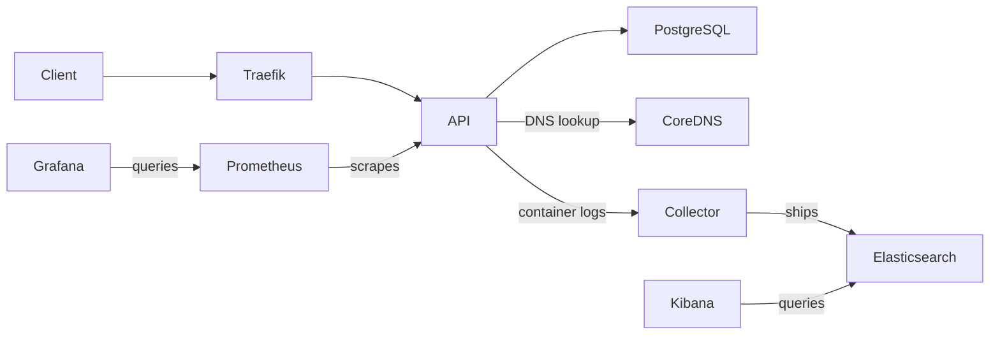

# Architecture

## Paths

Prometheus pulls metrics. The API resolves the database Service via CoreDNS. JSON stdout is collected from Kubernetes container logs. Generate synthetic requests from an in-cluster workload through Traefik, plus a host probe that verifies the loopback ingress path. Use distinct lab and observability namespaces. The controller records a run ID locally; request IDs are generated per request and are not correlated to the lifecycle run ID.

## Topology and layout

- Default cluster has one K3s server and two agents. PostgreSQL and Elasticsearch stay on the server so draining a worker does not evict their local persistent volumes. The API uses worker node labels and topology spread across both agents. The worker exercise checks that two API replicas are ready on separate agents before draining either one.
- Keep cluster config under cluster/, app and traffic sources under app/, baseline Kubernetes resources under deploy/, provisioning under observability/, scenario patches under scenarios/, CLI implementation under scripts/, and automated verification under tests/.
- Bind the ingress ports declared in `cluster/k3d.yaml` to loopback (`8080` and `8443`). Use loopback-bound port forwarding on `3000` and `5601` for the admin UIs. Keep database and Elasticsearch cluster-internal. Keep project-specific kubeconfig and lifecycle state in gitignored .lab/.
- Label lab-owned resources and stamp a random per-cluster owner token on the
  k3d nodes. Keep the token in the ignored `.lab/owner.json`. Resolve namespace,
  context, and cluster identity explicitly in every command. Use a single local
  lock for mutations and atomic writes for lifecycle state.
- Require `.lab/` and private controller files to be regular local paths; reject
  symlinks that could redirect credentials or kubeconfig operations outside the
  repository. Keep the directory at mode 0700 and private files at mode 0600.
  Teardown removes only known controller-owned files and preserves unknown
  files and directories in `.lab/`.

## Command contract

| Target | Contract |
| --- | --- |
| preflight | Check prerequisites, exact pinned k3d/kubectl/Python versions, and the documented minimum Docker Engine version, then check usable Docker, report Docker VM CPU/RAM and host checkout-filesystem free space against unmeasured planning estimates, and check ports before cluster mutation. Docker image-store capacity is not measured. Resource estimates are warnings, not support gates. |
| up | Create the lab namespace, server-side dry-run validate the baseline files and rendered observability Kustomize output through the private kubeconfig, verify that all three lab nodes report the pinned K3s kubelet version, then reconcile the healthy baseline and re-run Kibana bootstrap. Refuse an active incident and refuse a cluster whose teardown is in progress; finish teardown before starting again. |
| doctor | Probe ingress, DNS, database-backed reads, recent metrics, loaded Prometheus alert rules, an indexed request ID, and provisioned Grafana/Kibana dashboards. Label failed layers. |
| urls | Print accessible URLs or the exact commands required to open forwards. |
| lab-list / lab-status | Show the scenario catalog and safe local lifecycle summary; omit the blind capstone's numeric ID and redact its active title and selected worker. |
| lab-start LAB=05 | Validate the selected ID and healthy lifecycle state, lock, and persist starting state. Server-side dry-run validate declarative fault assets before applying them. Lab 12 instead proves the two-replica API/endpoints baseline, successful liveness and database-backed Orders requests, and exactly one Ready replica on each labeled worker before cordoning and draining a recorded worker. Wait for the observable symptom, then mark active. |
| lab-verify LAB=05 | Check sustained recovery and exercise-specific evidence without fixing anything. |
| lab-reset | Server-side dry-run validate baseline objects, restore project configuration, uncordon a recorded worker, restore two-worker API spread for the capstone, verify recovery, and clear active state only after successful checks. |
| down | Delete the named lab cluster and its lab-owned persistent data after ownership checks; allow an identity-verified teardown when the K3s version is stale or unavailable. Document removal before invocation. |
| diagnostics | Export allowlisted pod/node status and event type/reason/count, omitting raw object names, addresses, and event messages; redact blind capstone ID, title, and selected worker. |

An interrupted start, reset or teardown must be retryable. Record actionable failed state and preserve diagnosis. Refuse a second active lab. Exit 0 on success, 1 on failed check or operation, 2 on invalid usage or unsafe target. All waits have timeouts.
